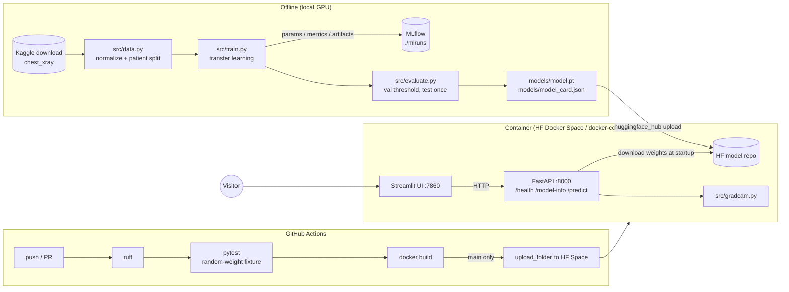

# PLAN: Chest X-ray Pneumonia Classifier

> **Disclaimer:** This is an educational demo. It is **not a medical device**
> and must **not be used for clinical diagnosis or any clinical decision.**

## 1. Goal

Build a binary image classifier (**NORMAL** vs **PNEUMONIA**) for pediatric
chest X-rays, and ship it the way a production system would be shipped:
tracked experiments, a tested inference API with explainability (Grad-CAM),
a web UI, containers, and CI/CD to a public demo.

**Dataset:** Kermany et al., *Labeled Optical Coherence Tomography (OCT) and
Chest X-Ray Images for Classification*, Mendeley Data (CC BY 4.0), via the
Kaggle mirror `paultimothymooney/chest-xray-pneumonia`. Pediatric patients,
ages 1-5, from Guangzhou Women and Children's Medical Center.

## 2. Architecture

| Component | Technology | Responsibility |
|---|---|---|
| Data pipeline | `src/data.py` | Normalize raw download, **patient-level** train/val split, transforms |
| Model | `src/model.py` | Transfer learning, ImageNet weights (DenseNet121 / EfficientNet-B0 on GPU, ResNet18 fallback on CPU) |
| Training | `src/train.py` | Class-weighted loss, light augmentation, MLflow logging |
| Evaluation | `src/evaluate.py` | Threshold selection on **validation**, single **test** evaluation, model card |
| Explainability | `src/gradcam.py` | Grad-CAM on the last conv layer |
| Experiment tracking | MLflow (local file store `./mlruns`) | Params, per-epoch metrics, confusion matrix, ROC curve, model artifact |
| Inference API | FastAPI (`api/`) | `/health`, `/model-info`, `/predict` (returns a Grad-CAM overlay) |
| Frontend | Streamlit (`ui/`) | Upload or sample images, prediction, probability, heatmap, model card |
| Packaging | Docker (`docker/`), docker-compose | One CPU-only image running the API (8000, internal) and the UI (7860) |
| CI/CD | GitHub Actions (`.github/workflows/`) | ruff, pytest, docker build; deploy to a HF Docker Space on `main` |
| Weight hosting | Hugging Face model repo | `model.pt` and `model_card.json`, downloaded at startup, **never in git** |

### Component diagram

## 3. Data plan

1. Copy the kagglehub download into `data/` and normalize it into a single
   `data/chest_xray/{train,test}/{NORMAL,PNEUMONIA}`. Remove the duplicated
   nested `chest_xray/chest_xray` folder and `__MACOSX` junk.
2. The official `val/` split has only 16 images, so it is not used as a
   validation set. Carve **~15% of train** into a new validation set,
   **split by patient**: every image from one patient (`personNNN_...`) stays
   in the same split, which prevents leakage that would inflate validation
   scores.
3. Report the class balance of every split.
4. The official `test/` split is the held-out test set. It is not touched
   until the final evaluation.

## 4. Modeling plan

- GPU detected (RTX 4060 Laptop, 8 GB): DenseNet121 or EfficientNet-B0 with
  ImageNet weights. If no GPU: ResNet18 at 224px, backbone frozen except the
  last block, and one epoch is timed before committing to a full run.
- Class imbalance (about 3:1 pneumonia) is handled with class-weighted
  cross-entropy.
- Light augmentation: small rotation, brightness/contrast jitter.
  **No horizontal flips**, because heart position (dextrocardia) is
  anatomically meaningful.
- 2-3 MLflow runs that vary learning rate and/or unfreezing depth. The best
  run is chosen by **validation AUC**.

## 5. PRE-REGISTERED evaluation criteria

These were written and committed **before any training**. They will not be
changed after results are seen.

| # | Criterion | Target | Set used |
|---|---|---|---|
| 1 | **Primary metric: ROC-AUC** | **>= 0.90** | Held-out test |
| 2 | **Sensitivity** (pneumonia recall) at the chosen threshold | **>= 0.95** | Held-out test |
| 3 | **Specificity** at the chosen threshold | Reported honestly, whatever it is (no target) | Held-out test |
| 4 | Decision threshold chosen on the **validation set only** | Process rule | Validation |
| 5 | Test set evaluated **once**, at the end, with no tuning against it | Process rule | Test |

**Rationale:** this is framed as a screening tool. A missed pneumonia (false
negative) costs more than a false alarm (false positive), so the threshold
favors sensitivity, and specificity is expected to pay for it.

**Threshold procedure:** on the validation set, choose the highest threshold
that still gives sensitivity >= 0.95. That single fixed threshold is then
applied to the test set.

**Results** (filled in after the single test evaluation, pass/fail, including
any failures): _pending_.

## 6. Phases

| Phase | Scope | Status |
|---|---|---|
| 1 | Plan, scaffold, venv, requirements, CLAUDE.md, first commit | Done |
| 2 | Data normalization, patient split, training + MLflow, threshold, single test eval, model card | Pending |
| 3 | FastAPI service, Grad-CAM, pytest (random-weight fixture), ruff | Pending |
| 4 | Streamlit UI, Dockerfile (API + UI), docker-compose | Pending |
| 5 | HF model repo upload, GitHub Actions CI/CD, HF Space deploy | Pending |
| 6 | Portfolio README, demo script | Pending |

## 7. Known limitations (to be stated everywhere results appear)

- Single dataset from a single hospital source, so generalization is unknown.
- Pediatric images only (ages 1-5).
- Known risk that the model learns scanner, positioning, or text-marker
  artifacts instead of pathology. Grad-CAM is used to inspect this, but it
  does not prove it isn't happening.
- Not clinically validated. Not a medical device.
