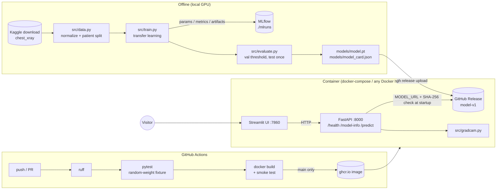

# PLAN: Chest X-ray Pneumonia Classifier

> **Disclaimer:** This is an educational demo. It is **not a medical device**
> and must **not be used for clinical diagnosis or any clinical decision.**

## 1. Goal

Build a binary image classifier (**NORMAL** vs **PNEUMONIA**) for pediatric
chest X-rays, and ship it the way a production system would be shipped:
tracked experiments, a tested inference API with explainability (Grad-CAM),
a web UI, containers, and CI/CD to a public demo.

**Dataset:** Kermany et al., *Labeled Optical Coherence Tomography (OCT) and
Chest X-Ray Images for Classification*, Mendeley Data (CC BY 4.0), via the
Kaggle mirror `paultimothymooney/chest-xray-pneumonia`. Pediatric patients,
ages 1-5, from Guangzhou Women and Children's Medical Center.

## 2. Architecture

| Component | Technology | Responsibility |
|---|---|---|
| Data pipeline | `src/data.py` | Normalize raw download, **patient-level** train/val split, transforms |
| Model | `src/model.py` | Transfer learning, ImageNet weights (DenseNet121 / EfficientNet-B0 on GPU, ResNet18 fallback on CPU) |
| Training | `src/train.py` | Class-weighted loss, light augmentation, MLflow logging |
| Evaluation | `src/evaluate.py` | Threshold selection on **validation**, single **test** evaluation, model card |
| Explainability | `src/gradcam.py` | Grad-CAM on the last conv layer |
| Experiment tracking | MLflow (local file store `./mlruns`) | Params, per-epoch metrics, confusion matrix, ROC curve, model artifact |
| Inference API | FastAPI (`api/`) | `/health`, `/model-info`, `/predict` (returns a Grad-CAM overlay) |
| Frontend | Streamlit (`ui/`) | Upload or sample images, prediction, probability, heatmap, model card |
| Packaging | Docker (`docker/`), docker-compose | One CPU-only image running the API (8000, internal) and the UI (7860) |
| CI/CD | GitHub Actions (`.github/workflows/`) | ruff, pytest, docker build + container smoke test; publish image to GHCR on `main` |
| Weight hosting | GitHub Release asset (`model-v1`) | `model.pt` and `model_card.json`, downloaded at startup from `MODEL_URL` and checked against a SHA-256, **never in git** |

> **Change (Phase 5):** Hugging Face (model repo and Docker Space) was dropped
> at the user's request. Weights are now a GitHub Release asset, and the
> deployable artifact is a public container image on GHCR that can run on any
> Docker host.

### Component diagram

## 3. Data plan

1. Copy the kagglehub download into `data/` and normalize it into a single
   `data/chest_xray/{train,test}/{NORMAL,PNEUMONIA}`. Remove the duplicated
   nested `chest_xray/chest_xray` folder and `__MACOSX` junk.
2. The official `val/` split has only 16 images, so it is not used as a
   validation set. Carve **~15% of train** into a new validation set,
   **split by patient**: every image from one patient (`personNNN_...`) stays
   in the same split, which prevents leakage that would inflate validation
   scores.
3. Report the class balance of every split.
4. The official `test/` split is the held-out test set. It is not touched
   until the final evaluation.

### Data findings (Phase 2, recorded before training)

- The raw download contains the dataset twice: `chest_xray/` and a nested
  `chest_xray/chest_xray/` copy that has an extra `.DS_Store` per folder.
  It also contains `__MACOSX/`. Only the top-level copy is used.
- The official 16-image `val/` is folded back into train before the
  patient-level split.
- Patient keys: PNEUMONIA `personN_{bacteria|virus}_K` -> `personN`;
  NORMAL `IM-XXXX-K` / `NORMAL2-IM-XXXX-K` -> the prefix before the last
  `-K`. 808 `personN` IDs in train have both bacteria and virus images,
  so grouping by `personN` alone is the conservative choice (it may merge
  two people, but never splits one).
- **Possible train/test leakage in the official split:** 170 pneumonia
  patient-ID strings occur in both official train and official test. They
  never share the same pathogen type and no filenames are identical, so they
  may be reused numbers rather than the same people. This cannot be verified
  from the data. The official test set is kept unchanged (as pre-registered
  and as used in the literature), and this caveat is reported with the
  results.

## 4. Modeling plan

- GPU detected (RTX 4060 Laptop, 8 GB): DenseNet121 or EfficientNet-B0 with
  ImageNet weights. **Chosen: DenseNet121** (AMP, batch 32, AdamW, cosine
  schedule, 8 epochs, about 17-22 s per epoch on AC power). Augmentation
  runs batched on the GPU. If no GPU: ResNet18 at 224px, backbone frozen except the
  last block, and one epoch is timed before committing to a full run.
- Class imbalance (about 3:1 pneumonia) is handled with class-weighted
  cross-entropy.
- Light augmentation: small rotation, brightness/contrast jitter.
  **No horizontal flips**, because heart position (dextrocardia) is
  anatomically meaningful.
- 2-3 MLflow runs that vary learning rate and/or unfreezing depth. The best
  run is chosen by **validation AUC**.

## 5. PRE-REGISTERED evaluation criteria

These were written and committed **before any training**. They will not be
changed after results are seen.

| # | Criterion | Target | Set used |
|---|---|---|---|
| 1 | **Primary metric: ROC-AUC** | **>= 0.90** | Held-out test |
| 2 | **Sensitivity** (pneumonia recall) at the chosen threshold | **>= 0.95** | Held-out test |
| 3 | **Specificity** at the chosen threshold | Reported honestly, whatever it is (no target) | Held-out test |
| 4 | Decision threshold chosen on the **validation set only** | Process rule | Validation |
| 5 | Test set evaluated **once**, at the end, with no tuning against it | Process rule | Test |

**Rationale:** this is framed as a screening tool. A missed pneumonia (false
negative) costs more than a false alarm (false positive), so the threshold
favors sensitivity, and specificity is expected to pay for it.

**Threshold procedure:** on the validation set, choose the highest threshold
that still gives sensitivity >= 0.95. That single fixed threshold is then
applied to the test set.

### Results (single test evaluation, 2026-11-17)

Selected model: **DenseNet121**, full fine-tune, lr 3e-4, best epoch 7
(MLflow run `dn121_full_lr3e-4`). Chosen by **validation AUC**.
Threshold from validation: **t = 0.316** (validation sensitivity 0.986,
specificity 1.000).

| # | Criterion | Target | Result (test, n=624) | Verdict |
|---|---|---|---|---|
| 1 | ROC-AUC | >= 0.90 | **0.982** | **PASS** |
| 2 | Sensitivity @ t=0.316 | >= 0.95 | **0.992** (387/390; 3 missed pneumonias) | **PASS** |
| 3 | Specificity @ t=0.316 | report honestly | **0.739** (173/234; **61 false alarms**) | Reported, and it is weak |
| 4 | Threshold chosen on validation only | process | Yes | **PASS** |
| 5 | Test evaluated once, no tuning | process | Yes (see note) | **PASS** |

Other test metrics: PPV 0.864, NPV 0.983, accuracy 0.897.
Confusion matrix (test): TN 173 · FP 61 · FN 3 · TP 387.

**Honest reading of these numbers:**
- **Specificity drops sharply from validation (1.00) to test (0.74).** The
  validation set comes from the same pool as training, so it was too easy:
  it could not reveal this. The official test set behaves like a shifted
  distribution, and about 1 in 4 healthy children would be flagged. In a
  screening setting that means many unnecessary follow-ups. This is the
  model's main weakness.
- The threshold rule ("highest threshold with validation sensitivity >=
  0.95") actually reached 0.986 validation sensitivity, because validation
  specificity was already perfect. On test this produced high sensitivity at
  the expense of specificity.
- The validation AUCs of the two full-fine-tune runs tied to 6 decimals
  (0.999470). The lr 3e-4 run was selected by MLflow's ordering. No test
  information was used to break the tie.
- Possible train/test patient-ID overlap in the official split (Section 3)
  may inflate test results. This cannot be ruled out.

**Process note (disclosed for transparency):** the first run of
`src.evaluate final` computed test predictions and then crashed while
writing JSON (a numpy bool was not serializable), before any metric was
printed or saved. Only the serialization was fixed. The same frozen model
and the same validation-derived threshold were used, and the rerun is the
only time test metrics were seen. `models/test_results.json` now blocks any
further test evaluation.

MLflow runs (validation, best epoch):

| Run | Unfrozen | LR | Best val AUC | Val threshold | Val sens / spec |
|---|---|---|---|---|---|
| dn121_full_lr3e-4 (selected) | all | 3e-4 | 0.99947 | 0.316 | 0.986 / 1.000 |
| dn121_full_lr1e-4 | all | 1e-4 | 0.99947 | 0.520 | 0.985 / 1.000 |
| dn121_last1_lr1e-3 | denseblock4 + head | 1e-3 | 0.99823 | 0.800 | 0.957 / 1.000 |

## 6. Phases

| Phase | Scope | Status |
|---|---|---|
| 1 | Plan, scaffold, venv, requirements, CLAUDE.md, first commit | Done |
| 2 | Data normalization, patient split, training + MLflow, threshold, single test eval, model card | Done |
| 3 | FastAPI service, Grad-CAM, pytest (random-weight fixture), ruff | Done |
| 4 | Streamlit UI, Dockerfile (API + UI), docker-compose | Done |
| 5 | Weights as GitHub Release asset, GitHub Actions CI/CD, image published to GHCR | Done |
| 6 | Portfolio README, demo script | Done |

## 7. Known limitations (to be stated everywhere results appear)

- Single dataset from a single hospital source, so generalization is unknown.
- Pediatric images only (ages 1-5).
- Known risk that the model learns scanner, positioning, or text-marker
  artifacts instead of pathology. Grad-CAM is used to inspect this, but it
  does not prove it isn't happening.
- Not clinically validated. Not a medical device.
