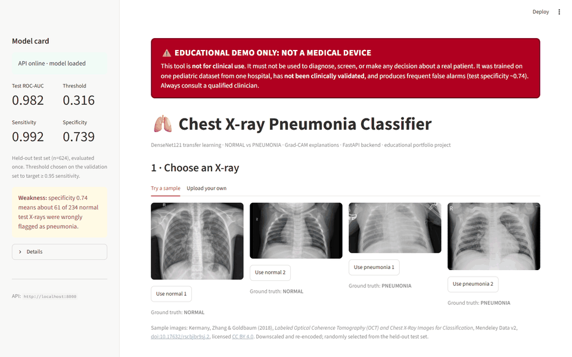
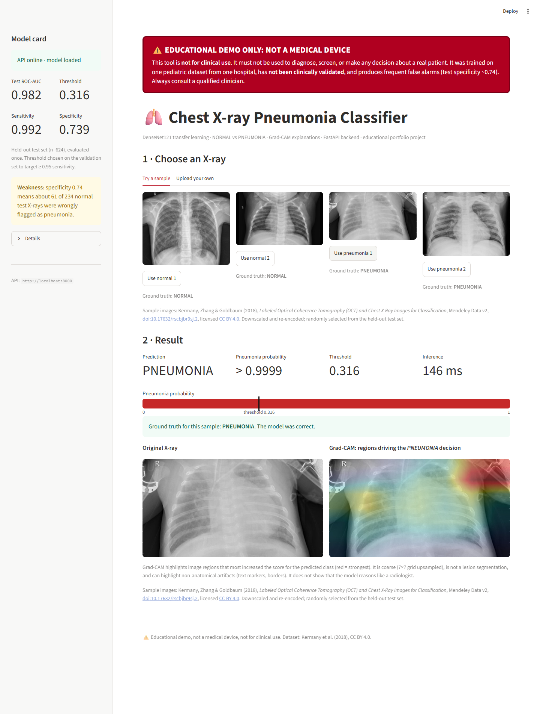
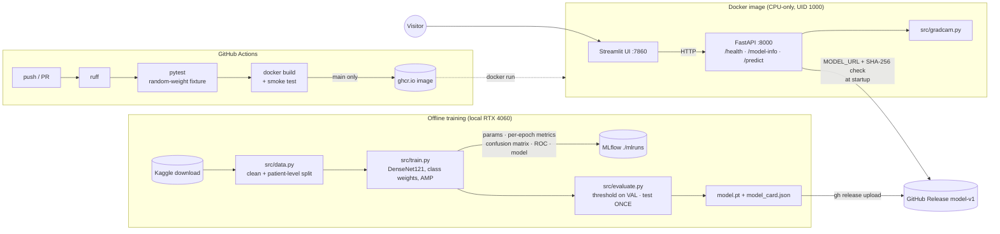

# 🫁 Chest X-ray Pneumonia Classifier

[](https://github.com/HansTeee/chest-xray-classifier/actions/workflows/ci-cd.yml)
[](https://github.com/HansTeee/chest-xray-classifier/pkgs/container/chest-xray-classifier)
[](https://github.com/HansTeee/chest-xray-classifier/releases/tag/model-v1)

**▶ Run the demo:** one command, no setup beyond Docker. It pulls the published
image, downloads the weights at startup, and serves the UI on
**http://localhost:7860**.

```cmd
docker run -p 7860:7860 ghcr.io/hansteee/chest-xray-classifier:latest
```

> *There is no hosted live demo yet. The deployable artifact is the public
> container image above, which CI builds, smoke-tests, and publishes on every
> push to `main`.*

> ⚠️ **EDUCATIONAL DEMO ONLY. NOT A MEDICAL DEVICE. NOT FOR CLINICAL USE.**
> This project must not be used to diagnose, screen, or make any decision about
> a real patient. It was trained on a single pediatric dataset, has not been
> clinically validated, and produces frequent false alarms.

An end-to-end ML engineering project: a DenseNet121 transfer-learning
classifier (NORMAL vs PNEUMONIA) for pediatric chest X-rays, with Grad-CAM
explanations on every prediction, MLflow experiment tracking, a FastAPI
inference service, a Streamlit frontend, a single CPU-only Docker image, and
GitHub Actions CI/CD. Evaluation criteria were **pre-registered before
training** and are reported pass/fail below, including the weak ones.



<details>
<summary>Full screenshot</summary>



</details>

**Read the heatmap critically.** In the example above, the model is correct
(PNEUMONIA, ground truth PNEUMONIA), but Grad-CAM's strongest activation sits
on the patient's **left shoulder and soft tissue at the image edge, outside
the lungs**, with only moderate activation over the lung fields. This is a
concrete example of the shortcut-learning risk listed under
[Limitations](#limitations). A correct answer does not mean it was correct for
the right reason.

---

## Results vs. pre-registered criteria

The criteria were committed in [`PLAN.md`](PLAN.md) **before any training**
(commit `953ef40`). The test set (official Kermany test split, n = 624) was
evaluated **once**.

| # | Criterion | Target | Result (test) | Verdict |
|---|---|---|---|---|
| 1 | ROC-AUC (primary) | ≥ 0.90 | **0.982** | ✅ PASS |
| 2 | Sensitivity (pneumonia recall) at chosen threshold | ≥ 0.95 | **0.992** (387 / 390) | ✅ PASS |
| 3 | Specificity at chosen threshold | report honestly | **0.739** (173 / 234) | ⚠️ **Weak: 61 false alarms** |
| 4 | Threshold chosen on validation set only | process | t = 0.316 from validation | ✅ PASS |
| 5 | Test set evaluated once, no tuning | process | guard file blocks re-runs | ✅ PASS |

Other test metrics: PPV 0.864 · NPV 0.983 · accuracy 0.897.
Confusion matrix: TN 173 · FP 61 · FN 3 · TP 387.

**What these numbers mean:**
- **Specificity is the main weakness.** It was 1.000 on validation and 0.739
  on test. The validation set comes from the same source pool as training, so
  it could not reveal this shift. Roughly **1 in 4 healthy children would be
  flagged**. The threshold favors sensitivity by design (a missed pneumonia
  costs more in screening), but the drop is larger than validation suggested.
- **The model is badly overconfident.** Probabilities are often < 0.0001 or
  > 0.9999, and the model has not been calibrated. Read the probability as a
  ranking score, not a likelihood.
- **Process disclosure:** the first final-evaluation run crashed while writing
  JSON, after computing test predictions but before any metric was seen. Only
  the serialization bug was fixed, and the frozen model and threshold were
  re-run. Details are in [PLAN.md §5](PLAN.md).

**Experiment comparison** (MLflow, validation set, best epoch):

| Run | Trainable | LR | Val AUC | Val threshold | Val sens / spec |
|---|---|---|---|---|---|
| `dn121_full_lr3e-4` ✔ selected | all layers | 3e-4 | 0.99947 | 0.316 | 0.986 / 1.000 |
| `dn121_full_lr1e-4` | all layers | 1e-4 | 0.99947 | 0.520 | 0.985 / 1.000 |
| `dn121_last1_lr1e-3` | last dense block + head | 1e-3 | 0.99823 | 0.800 | 0.957 / 1.000 |

The two full fine-tune runs tied on validation AUC to six decimals. The tie
was broken by MLflow's sort order, with no test information involved.

---

## Architecture



| Component | Path | Notes |
|---|---|---|
| Data pipeline | `src/data.py` | Cleans the raw download, patient-level split, GPU-batched augmentation |
| Model | `src/model.py` | DenseNet121 / EfficientNet-B0 / ResNet18 factory, partial unfreezing |
| Training | `src/train.py` | Class-weighted CE, AdamW + cosine, AMP, MLflow logging |
| Evaluation | `src/evaluate.py` | Validation threshold, single guarded test run, model card |
| Grad-CAM | `src/gradcam.py` | Hooks on `features.norm5`, overlay without matplotlib |
| API | `api/main.py` | Input validation (400/413/415/422), disclaimer in OpenAPI docs |
| UI | `ui/app.py` | Samples + upload, probability bar with threshold, model card sidebar |
| Container | `docker/` | One image runs both services; `start.sh` exits if either dies |
| CI/CD | `.github/workflows/ci-cd.yml` | ruff → pytest → build + smoke test → publish |

**API endpoints** (interactive docs at `http://localhost:8000/docs` when running locally):

| Method | Path | Returns |
|---|---|---|
| GET | `/health` | Service status and whether the model is loaded |
| GET | `/model-info` | Full `model_card.json` (architecture, threshold, metrics, dataset) |
| POST | `/predict` | `label`, `pneumonia_probability`, `threshold`, `inference_ms`, `gradcam_png_base64` |

---

## Engineering decisions worth calling out

**Patient-level split to prevent leakage.** The official validation split has
only 16 images, so I carved 15% of *patients* out of train. Pneumonia
filenames encode a person ID (`person123_bacteria_456.jpeg`). Every image of a
patient stays in one split, and a check asserts that no patient appears in
both train and validation. Splitting by image would put near-duplicate
X-rays of the same child on both sides and inflate validation scores. I also
found that 170 pneumonia patient IDs occur in both the *official* train and
test sets. They never share a pathogen type, so they may be reused numbers,
but this can't be verified, so it is disclosed as a caveat rather than fixed
silently.

**Threshold chosen on validation only.** The operating point is the highest
threshold reaching ≥ 0.95 sensitivity on the validation set (t = 0.316). It
was frozen before the test set was touched.

**Single test evaluation, enforced in code.** `python -m src.evaluate final`
writes `models/test_results.json`. Every later invocation refuses to run, so
"evaluate on test once" is a guarantee rather than a promise. Model selection
across runs used validation AUC only.

**No horizontal flips.** Chest X-rays aren't left-right symmetric: the heart
sits on the left, and dextrocardia is a real finding. Augmentation is limited
to ±10° rotation, ±5% shift/scale, and ±20% brightness/contrast, run batched
on the GPU. A unit test confirms the augmentation never mirrors an image.

**CPU-only serving image.** Training used CUDA 12.4 torch. The serving image
installs `torch==2.5.1+cpu` from the PyTorch CPU index, which avoids about 2 GB
of CUDA libraries. Inference plus Grad-CAM takes about 150-600 ms per image on
CPU (measured locally; the first request after startup is slower). Image size: 2.07 GB on disk, **444 MB compressed**. Weights are never
baked into the image or committed to git. They are downloaded from a GitHub
Release at startup and verified by SHA-256.

**Tests without weights or network.** The pytest fixture builds the same
DenseNet121 architecture with random weights, so CI is fast and self-contained.
Weight-download tests use `file://` URLs. There are 26 tests covering the
endpoints, every rejection path, Grad-CAM output dimensions, patient-ID
parsing, and the no-flip guarantee.

---

## Limitations

- **Single dataset, single hospital.** All images come from Guangzhou Women
  and Children's Medical Center. Performance on other hospitals, scanners,
  or populations is unknown and likely worse.
- **Pediatric only (ages 1-5).** It says nothing about adult chest X-rays.
- **Shortcut learning risk.** CNNs on this dataset are known to pick up
  scanner signatures, positioning, burned-in text markers (the "R" laterality
  label), and image borders instead of pathology. Grad-CAM shows mixed
  behavior here: on some images it concentrates on lung opacities, but on the
  README example its strongest activation is the shoulder at the image edge.
  Grad-CAM is a coarse 7×7 map and can neither prove nor rule out shortcut
  learning.
- **Possible train/test overlap** in the official split (see above), which
  could inflate test metrics.
- **Weak specificity and uncalibrated probabilities**, as shown in the results.
- **Not clinically validated.** It has had no prospective evaluation, no
  regulatory review, and no radiologist comparison.

---

## Run it locally (Windows CMD)

**Option A: published image** (no clone needed)
```cmd
docker run -p 7860:7860 -p 8000:8000 ghcr.io/hansteee/chest-xray-classifier:latest
```
UI: http://localhost:7860 · API docs: http://localhost:8000/docs

**Option B: build from source with docker compose**
```cmd
git clone https://github.com/HansTeee/chest-xray-classifier.git
cd chest-xray-classifier
docker compose up --build
```
If `models\` is empty, the container downloads the weights from the release automatically.

**Option C: Python dev environment** (Python 3.11)
```cmd
py -3.11 -m venv .venv
.venv\Scripts\activate
python -m pip install --index-url https://download.pytorch.org/whl/cpu torch==2.5.1 torchvision==0.20.1
python -m pip install -r requirements-dev.txt
python -m pytest
python -m ruff check .
```
Download the weights into `models\`, then start the API and the UI in two terminals:
```cmd
curl -L -o models\model.pt https://github.com/HansTeee/chest-xray-classifier/releases/download/model-v1/model.pt
curl -L -o models\model_card.json https://github.com/HansTeee/chest-xray-classifier/releases/download/model-v1/model_card.json
uvicorn api.main:app --port 8000
```
```cmd
.venv\Scripts\activate
streamlit run ui/app.py
```

**Reproduce training** (needs an NVIDIA GPU; keep a laptop plugged in, since it
ran about 5× slower on battery):
```cmd
python -m pip install -r requirements-train.txt
python -c "import kagglehub; print(kagglehub.dataset_download('paultimothymooney/chest-xray-pneumonia'))"
python -m src.data prepare --src "<path printed above>"
python -m src.data split
python -m src.train --run-name dn121_full_lr1e-4 --lr 1e-4 --unfreeze all
python -m src.train --run-name dn121_full_lr3e-4 --lr 3e-4 --unfreeze all
python -m src.train --run-name dn121_last1_lr1e-3 --lr 1e-3 --unfreeze 1
python -m src.evaluate final
mlflow ui --backend-store-uri ./mlruns
```
`src.evaluate final` runs the test set **once**. Delete `models\test_results.json`
only if you are starting a genuinely new experiment.

---

## How CI/CD works

[`.github/workflows/ci-cd.yml`](.github/workflows/ci-cd.yml) runs on every push and pull request:

1. **Lint & test:** `ruff check`, `ruff format --check`, then `pytest` with CPU torch.
2. **Docker build & smoke test:** builds the image with the GitHub Actions
   layer cache and starts the container. The container downloads the real
   weights from the release and verifies the SHA-256. CI then waits for both
   services, POSTs a pneumonia sample to `/predict` and asserts the label is
   `PNEUMONIA`, and asserts a non-image upload returns HTTP 415.
3. **Publish** (push to `main` only, and only if 1 and 2 pass): pushes
   `ghcr.io/hansteee/chest-xray-classifier:latest` and `:sha-<commit>`.

New weights mean a new release tag, plus updating `MODEL_URL` and `MODEL_SHA256`
in `docker/Dockerfile`.

---

## Disclaimer

This is an **educational portfolio project**. It is **not a medical device**,
has **not been clinically validated**, and must **not be used for clinical
diagnosis, screening, triage, or any decision about a real patient**. Always
consult a qualified clinician.

## Dataset attribution

Kermany, D., Zhang, K., Goldbaum, M. (2018). *Labeled Optical Coherence
Tomography (OCT) and Chest X-Ray Images for Classification.* Mendeley Data, v2.
[doi:10.17632/rscbjbr9sj.2](https://doi.org/10.17632/rscbjbr9sj.2). Licensed
[CC BY 4.0](https://creativecommons.org/licenses/by/4.0/). Accessed through the
Kaggle mirror `paultimothymooney/chest-xray-pneumonia`. The four sample images
in `ui/samples/` are downscaled, re-encoded test-set images (see
[`ui/samples/ATTRIBUTION.md`](ui/samples/ATTRIBUTION.md)).
